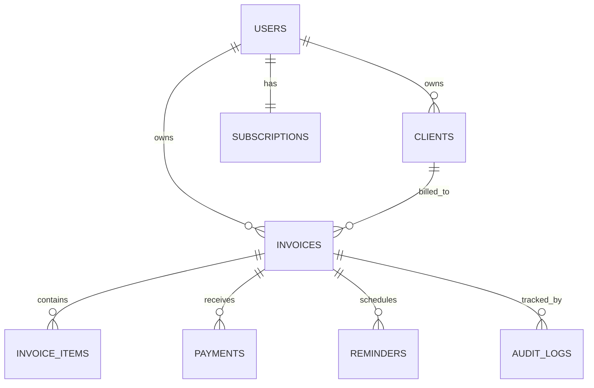

# Database Schema

Skema formal berdasarkan draft di `architecture.md`. Database: **PostgreSQL**, diakses via **Prisma ORM**. Semua nominal uang memakai tipe `Decimal` (bukan float) — lihat `ai-rules.md` bagian 3.

---

## 1. ERD (Ringkas)

---

## 2. Detail Tabel

### 2.1 `users`

| Kolom | Tipe | Constraint | Keterangan |
|---|---|---|---|
| `id` | `uuid` | PK, default `gen_random_uuid()` | |
| `name` | `varchar(255)` | not null | |
| `email` | `varchar(255)` | unique, not null | |
| `password_hash` | `varchar(255)` | **nullable** | Argon2id; `null` untuk user yang daftar via Google OAuth (tidak punya password) |
| `oauth_provider` | `enum('google')` | nullable | Diisi kalau akun dibuat/terhubung lewat OAuth |
| `oauth_id` | `varchar(255)` | nullable, unique bareng `oauth_provider` | `sub` claim dari Google ID token — bukan email, supaya tidak berubah kalau user ganti email Google |
| `plan` | `enum('free','pro')` | not null, default `free` | |
| `email_verified_at` | `timestamptz` | nullable | Otomatis terisi saat register kalau login via Google (email sudah terverifikasi Google) |
| `created_at` | `timestamptz` | not null, default `now()` | |
| `updated_at` | `timestamptz` | not null | |

> Catatan: kolom `password_hash` nullable berarti flow "lupa password" harus mengecek dulu apakah user ini punya password_hash — kalau tidak (akun Google-only), arahkan ke "Login pakai Google" bukan reset password.

### 2.1.1 `email_verifications`

| Kolom | Tipe | Constraint | Keterangan |
|---|---|---|---|
| `id` | `uuid` | PK | |
| `user_id` | `uuid` | FK → `users.id`, `ON DELETE CASCADE` | |
| `code_hash` | `varchar` | not null | Hash SHA-256 kode sekali pakai; kode mentah tidak disimpan |
| `expires_at` | `timestamptz` | not null | Kode berlaku 15 menit |
| `used_at` | `timestamptz` | nullable | Diisi saat verifikasi berhasil |
| `created_at` | `timestamptz` | not null, default `now()` | |

**Index:** `(user_id, expires_at)`.

### 2.2 `clients`

| Kolom | Tipe | Constraint | Keterangan |
|---|---|---|---|
| `id` | `uuid` | PK | |
| `user_id` | `uuid` | FK → `users.id`, not null, `ON DELETE CASCADE` | |
| `name` | `varchar(255)` | not null | |
| `email` | `varchar(255)` | nullable | |
| `phone` | `varchar(30)` | nullable | Untuk reminder via WA |
| `address` | `text` | nullable | |
| `created_at` | `timestamptz` | not null, default `now()` | |

**Index:** `(user_id)` — semua query client selalu discope by user, lihat `ai-rules.md` bagian 3 soal IDOR prevention.

### 2.3 `invoices`

| Kolom | Tipe | Constraint | Keterangan |
|---|---|---|---|
| `id` | `uuid` | PK | |
| `user_id` | `uuid` | FK → `users.id`, not null | |
| `client_id` | `uuid` | FK → `clients.id`, not null | |
| `invoice_number` | `varchar(50)` | unique per `user_id`, not null | Format `INV-{tahun}-{urutan}`, digenerate server-side |
| `status` | `enum('draft','sent','viewed','paid','overdue','cancelled')` | not null, default `draft` | |
| `issue_date` | `date` | not null | |
| `due_date` | `date` | not null | Wajib `>= issue_date` (validasi di service layer) |
| `subtotal` | `decimal(14,2)` | not null | |
| `tax_percent` | `decimal(5,2)` | not null, default `0` | |
| `discount_amount` | `decimal(14,2)` | not null, default `0` | |
| `total` | `decimal(14,2)` | not null | Dihitung server-side, tidak boleh dikirim langsung dari client |
| `currency` | `varchar(3)` | not null, default `IDR` | |
| `public_token` | `varchar(64)` | unique, not null | Token acak untuk akses halaman publik invoice (bukan ID sekuensial yang bisa ditebak) |
| `created_at` | `timestamptz` | not null, default `now()` | |
| `updated_at` | `timestamptz` | not null | |

**Index:** `(user_id, status)` untuk query dashboard ("invoice overdue saya"), `(public_token)` untuk akses halaman publik.

> Catatan keamanan: `public_token` sengaja dipisah dari `id` supaya ID internal (kalau numerik/sekuensial) tidak bisa dipakai menebak invoice lain. Lihat `architecture.md` 4.1 soal IDOR.

### 2.4 `invoice_items`

| Kolom | Tipe | Constraint | Keterangan |
|---|---|---|---|
| `id` | `uuid` | PK | |
| `invoice_id` | `uuid` | FK → `invoices.id`, not null, `ON DELETE CASCADE` | |
| `description` | `varchar(500)` | not null | |
| `quantity` | `decimal(10,2)` | not null, default `1` | |
| `unit_price` | `decimal(14,2)` | not null | |
| `subtotal` | `decimal(14,2)` | not null | `quantity * unit_price`, dihitung server-side |
| `sort_order` | `integer` | not null, default `0` | Urutan tampil di invoice |

### 2.5 `payments`

| Kolom | Tipe | Constraint | Keterangan |
|---|---|---|---|
| `id` | `uuid` | PK | |
| `invoice_id` | `uuid` | FK → `invoices.id`, not null | |
| `amount` | `decimal(14,2)` | not null | |
| `method` | `enum('manual','midtrans','xendit')` | not null | |
| `gateway_reference` | `varchar(255)` | nullable, unique jika ada | ID transaksi dari payment gateway |
| `paid_at` | `timestamptz` | not null | |
| `created_at` | `timestamptz` | not null, default `now()` | |

**Constraint tambahan (di level aplikasi):** total `payments.amount` untuk satu invoice tidak boleh melebihi `invoices.total` — divalidasi di service, bukan hanya di DB.

### 2.6 `reminders`

| Kolom | Tipe | Constraint | Keterangan |
|---|---|---|---|
| `id` | `uuid` | PK | |
| `invoice_id` | `uuid` | FK → `invoices.id`, not null | |
| `channel` | `enum('email','whatsapp')` | not null | |
| `scheduled_at` | `timestamptz` | not null | |
| `sent_at` | `timestamptz` | nullable | |
| `status` | `enum('pending','sent','failed')` | not null, default `pending` | |
| `failure_reason` | `text` | nullable | |

**Index:** `(scheduled_at, status)` — dipakai endpoint internal (dipanggil GitHub Actions cron tiap 15–30 menit) untuk query reminder yang harus dikirim (lihat `architecture.md` bagian 1.1 & 4.12). Query intinya: `WHERE scheduled_at <= now() AND status = 'pending'`.

### 2.7 `subscriptions`

Langganan **user ke aplikasi ini sendiri** (billing SaaS-nya, beda dari `payments` yang merupakan pembayaran klien ke invoice).

| Kolom | Tipe | Constraint | Keterangan |
|---|---|---|---|
| `id` | `uuid` | PK | |
| `user_id` | `uuid` | FK → `users.id`, unique, not null | |
| `plan` | `enum('free','pro')` | not null | |
| `status` | `enum('active','past_due','cancelled')` | not null | |
| `current_period_end` | `timestamptz` | nullable | |
| `gateway_customer_id` | `varchar(255)` | nullable | |

### 2.8 `audit_logs`

Sesuai `architecture.md` bagian 4.9 — log event sensitif terpisah dari log aplikasi biasa.

| Kolom | Tipe | Constraint | Keterangan |
|---|---|---|---|
| `id` | `uuid` | PK | |
| `user_id` | `uuid` | FK → `users.id`, nullable | Nullable untuk event sebelum login (contoh: login gagal) |
| `action` | `varchar(100)` | not null | Contoh: `login_failed`, `invoice_deleted`, `password_changed` |
| `resource_type` | `varchar(50)` | nullable | Contoh: `invoice` |
| `resource_id` | `uuid` | nullable | |
| `ip_address` | `varchar(45)` | nullable | |
| `created_at` | `timestamptz` | not null, default `now()` | |

---

## 3. Aturan Umum

- Semua tabel yang punya relasi ke `users` **wajib** difilter by `user_id` di setiap query (baik lewat `where` Prisma maupun row-level check) — tidak cukup mengandalkan hanya primary key. Lihat `ai-rules.md` bagian 3.
- Semua nominal uang: tipe `Decimal` di Prisma (`@db.Decimal(14,2)`), tidak pernah `Float`/`Int` biasa untuk uang.
- `deleted_at` (soft delete) dipertimbangkan untuk `invoices` dan `clients` di iterasi berikutnya, supaya data yang "dihapus" user tetap ada untuk keperluan audit/laporan pajak — belum wajib di MVP tapi disiapkan strukturnya kalau memang dibutuhkan.
- Migrasi database dikelola lewat Prisma Migrate (`npx prisma migrate dev` untuk lokal, `migrate deploy` untuk production) — tidak ada perubahan skema manual langsung di database production.
